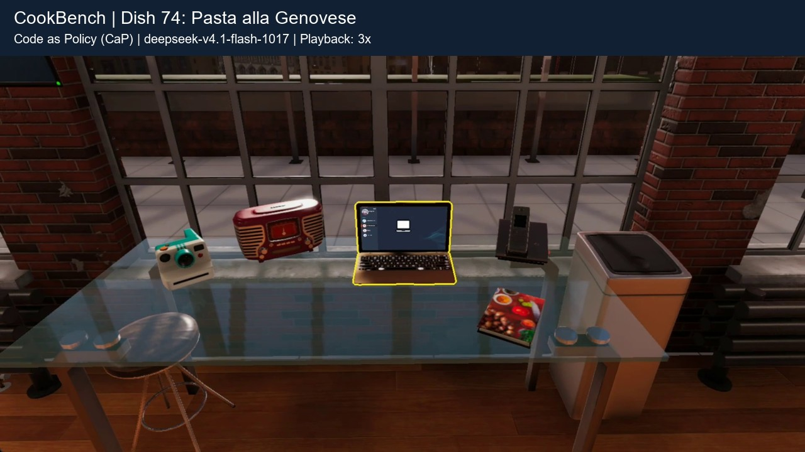

# Dish 74 episode demonstration

**Dish:** 74 — Pasta alla Genovese  
**Harness:** Code as Policy (CaP)  
**Model:** `deepseek-v4.1-flash-1017`  
**Playback:** 3x speed; silent  
**Format:** 1080p, H.264, 15 fps web copies

The complete recording is split chronologically into five files, each below 100 MB for anonymous hosting. The timeline is preserved, including execution difficulties, physical object displacement, recovery attempts, and the final in-game evaluation screen.

| Part | Video time | Video |
| --- | --- | --- |
| 1 | 00:00–10:00 | [Watch / download part 1](part-01.mp4) |
| 2 | 10:00–20:04 | [Watch / download part 2](part-02.mp4) |
| 3 | 20:04–30:07 | [Watch / download part 3](part-03.mp4) |
| 4 | 30:07–40:01 | [Watch / download part 4](part-04.mp4) |
| 5 | 40:01–45:36 | [Watch / download part 5](part-05.mp4) |

[Configuration, exact durations and SHA-256 checksums](metadata.json).
